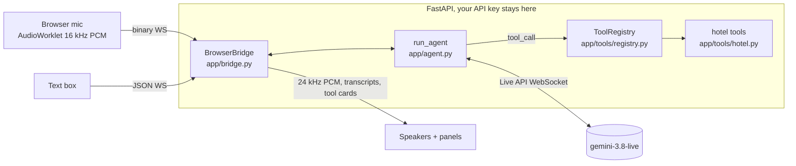

# The Saffron Palm: a bilingual voice receptionist on the Gemini Live API

This repo is a live-coding workshop for GDG DevFest Dubai. Layla answers the phone at the fictional **Saffron Palm Hotel, Dubai Marina**, in English or Arabic. She checks availability, books rooms, answers questions and logs room service.

The whole Live API loop is **20 lines**, in one fenced block in [app/agent.py](app/agent.py). Everything else is scaffolding you can reuse.

## Quickstart

You need [uv](https://docs.astral.sh/uv/) and a Gemini API key from [AI Studio](https://aistudio.google.com/apikey).

```bash
uv sync
cp .env.example .env        # then paste your GEMINI_API_KEY into .env
uv run uvicorn app.server:app
```

Open http://localhost:8000, **put on headphones**, press the mic and ask: *"Do you have a double room next Friday?"*

Before a talk, run `uv run python scripts/smoke_test.py` on the venue Wi-Fi. It opens a real session and checks that the model calls `check_availability`.

## How it works



The fenced block does four things:
1. It opens `client.aio.live.connect(...)` with `build_live_config(...)`, which sets the voice, persona, transcription, VAD and tools.
2. It forwards `bridge.inputs()`, which can be mic audio or typed text, into `session.send_realtime_input(**item)`.
3. It loops over `session.receive()` and does the following with each message:
   - plays `msg.data` (the agent's audio)
   - flushes playback on `interrupted`
   - forwards transcripts to the browser

   `receive()` ends after every turn, which is why it sits inside `while True`.
4. It answers each `tool_call` with `session.send_tool_response(...)`. This runs as a task, because `gemini-3.8-live` calls functions **asynchronously** by default and the agent keeps talking while `check_availability` takes its 2 seconds.

The google-genai SDK is pinned to `google-genai==2.31.0`.

## Workshop flow (about 40 minutes)

Attendees can either type along in `app/agent.py` or start from the stub. `uv run python scripts/make_starter.py` writes `starter/agent.py`, and `cp starter/agent.py app/agent.py` puts it in place. Use `git checkout app/agent.py` to get the solution back.

If you fall behind, copy the checkpoint over `app/agent.py`, e.g. `cp checkpoints/step3_tools.py app/agent.py`.

| Time | Checkpoint | What you add |
|---|---|---|
| 0–5 min | — | Run the finished demo and walk through the architecture |
| 5–15 min | [step1_talk](checkpoints/step1_talk.py) | `connect`, `send_realtime_input`, the `receive()` loop and `bridge.play`. Now you can talk to it |
| 15–20 min | [step2_persona](checkpoints/step2_persona.py) | No code. Edit [receptionist.md](app/persona/receptionist.md) and `VOICE` in `.env`, then try Arabic |
| 20–32 min | [step3_tools](checkpoints/step3_tools.py) | Pass the registry to the config and answer `tool_call`s. Watch the Front Desk panel |
| 32–40 min | [step4_bargein](checkpoints/step4_bargein.py) | `interrupted` → `bridge.interrupt()`, plus `bridge.transcript(msg)` |

## Make it your own

To build a different business, swap three files and change two lines in `.env`. You don't need to touch `agent.py`, `bridge.py` or `server.py`.

1. Write a persona, e.g. `app/persona/dentist.md`.
2. Write a tools module. Type hints and the docstring become the schema the model sees:

```python
# app/tools/clinic.py
from typing import Literal
from app.tools.registry import ToolError, tool

@tool
def book_appointment(patient: str, day: str, treatment: Literal["checkup", "cleaning", "whitening"]) -> dict:
    """Book a dental appointment.

    Args:
        patient: Patient's full name.
        day: ISO date, YYYY-MM-DD.
        treatment: Type of visit.
    """
    if not patient.strip():
        raise ToolError("I need the patient's name.")  # The agent says this out loud.
    return {"confirmation": "DEN-1042", "day": day, "treatment": treatment}
```

3. Point `.env` at the new files:

```
PERSONA_FILE=app/persona/dentist.md
TOOL_MODULES=app.tools.clinic,app.tools.call
```

- **Non-blocking tools:** use `@tool(blocking=False)` for slow lookups. The agent keeps talking and the result is announced when it pauses (`WHEN_IDLE`).
- **Errors:** raise `ToolError` for anything the guest should hear. Any other exception becomes a polite generic error, so the model never sees a stack trace.

**Longer calls.** Audio-only sessions are capped at about 15 minutes, and each connection lasts about 10 minutes. Uncomment `context_window_compression` and `session_resumption` in [config.py](app/config.py) to go beyond that.

**Browser-direct.** This app is server-to-server, so the key never reaches the browser. If you want the browser to talk to Gemini directly, mint short-lived [ephemeral tokens](https://ai.google.dev/gemini-api/docs/ephemeral-tokens) on your server, and never ship the real key to the browser.

## Troubleshooting

- **No mic prompt or "Permission denied".** Browsers only allow the mic on `https://` or `http://localhost`. Check the site permission next to the URL bar. If you are on a remote machine, use `localhost` port-forwarding rather than the machine's IP.
- **Chipmunk or slow-motion audio.** Gemini expects 16 kHz 16-bit mono PCM in and sends 24 kHz out. The capture worklet resamples from your device rate, and playback runs a 24 kHz `AudioContext`. If you change either side, keep those two rates.
- **The agent keeps interrupting itself.** It is hearing its own voice through your speakers. Wear headphones, or tap the mic button to mute while the agent talks (muting sends silence, so turn-taking still works). Echo cancellation helps, but projectors and room speakers defeat it.
- **It cuts people off mid-sentence.** Voice activity detection ends the turn after `silence_duration_ms` of silence. That is 700 ms here; keep it between 500 and 800 ms. Lower values chop up speech, and higher values feel sluggish.
- **The room is too noisy.** Use the text box. Typed text goes into the same session.
- **The session ends after about 10 minutes.** See "Longer calls" above.
